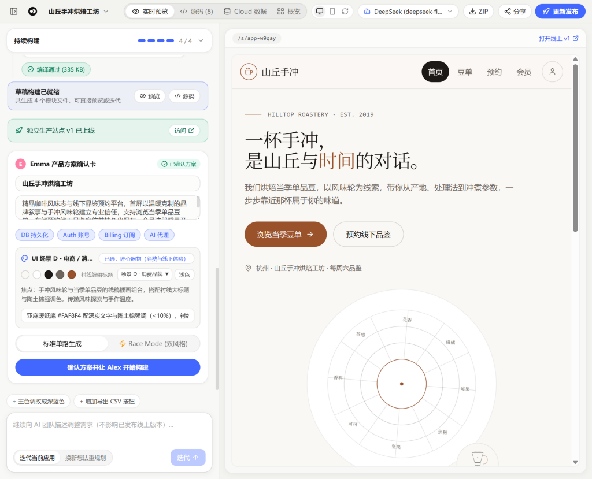
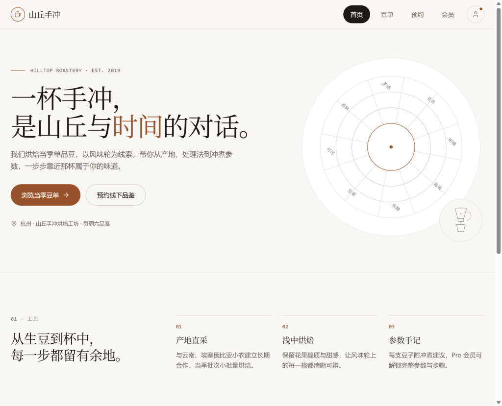

# Mini Atoms

- **在线工作台**：<https://xcodea.online>
- **示例站点**：<https://xcodea.online/s/app-otqlo>
- **GitHub**：<https://github.com/MrEdge123/atoms-demo>

用一句白话需求就能让 AI 产品团队帮你做出真正能用、能存数据、还能一键上线分享的网页应用。
打开工作台不需要注册账号，输入想法后先看方案再动手写代码，改满意后直接点发布，手机和朋友的电脑打开 `/s/[slug]` 就能访问，刷新页面数据也不会丢。





---

## 核心亮点

- **Atoms 全主流程真实闭环**：**Iris** 调研 → **Emma** 方案确认（`409` 硬门禁）→ **Alex** 内存 `esbuild` + Tailwind v4 编译自愈（≤2 轮）+ **Race Mode** 双风格对比 → 一键发布独立 `/s/[slug]`（真实 SEO/OG、二维码、ZIP 导出与跨重启持久化）。
- **真多智能体协作与防空转体验**：内置 **LLM 模型意图路由**（非硬编码规则）、消息任意位置独立 **`@mention` 徽章**与多角色分工进度卡；迭代时注入实时源码色板并拦截**仅改 `DESIGN.md` 不改代码**的空转输出；对照 Atoms 补齐项目与列表**慢网加载骨架屏**。
- **生产级同域安全与真线上验证**：HMAC 签名匿名会话隔离、防发布站冒用校验、Cloud AI 双维度限流、SQL 事务原子性；通过 **28 条** L1/L2 自动化测试、**18 步**本地/公网 HTTP 冒烟与腾讯云 Docker Compose + Caddy HTTPS 实网验证。
- **约 6 小时人工 × 双 Agent 无人值守闭环**：**Antigravity IDE + `/goal`** 主开发，配合 **Codex Desktop 每 15 分钟定时巡检**（卡死解卡 + 任务完成后自动驱动浏览器从**外部视角**做黑盒端到端/宽屏回归）与 `codex review --commit` 并行审查。

---

## 实现思路与关键取舍

采用 **「前端交互 + 平台托管 BaaS」** 轻全栈架构：AI 专注 React + Tailwind 前端交互与视觉，数据、鉴权、订阅与 AI 代理收敛到内置 `@atoms/cloud` SDK，并通过 `Ports & Adapters`（六边形架构）将 LLM、构建器、存储、发布与支付抽成可替换接口（详参 [02 - 范围界定与关键技术取舍](./docs/02-demo-scope-and-tradeoffs.md) 与 [03 - 轻全栈架构设计与三层测试闭环](./docs/03-architecture-design.md)）。

| 决策维度 | 选择方案 | 放弃方案 | 核心取舍理由 |
| :--- | :--- | :--- | :--- |
| **架构路线** | 轻全栈 + 内置 `@atoms/cloud` + 内存 `esbuild` | 每应用独立容器与数据库 | 在轻量云主机实现毫秒级编译反馈、极低运维成本，以及改版重发布零丢数据 |
| **发布与隔离** | 同域 `/s/[slug]` + 4 层安全防线 + 签名匿名 Cookie | 独立通配符子域名 + 完整平台账号体系 | 规避前期证书与账号复杂度，优先保证免登录即用体验与可验证的同域隔离边界 |
| **商业支付闭环** | 内置 Mock 收银台（HMAC Webhook）+ 预留 Creem 适配器 | 直接强依赖真实商用商户收单 | 将商户审核周期移出 2 天主路径，同时保持订阅升级 SQL 事务与接口形态真实可用 |
| **生成物审美控制** | 轻量主题预设 + `DESIGN.md` 设计规范注入 | 重型可视化拖拽/样式编辑器 | 在剩余 1 天的开发成本约束下，以最小复杂度显著拉升首屏视觉与一致性 |

---

## 当前完成程度

- **已完成**：
  - **核心 SOP 与编译闭环**：Iris → Emma（`409` 门禁）→ Alex（内存编译自愈 + 运行期异常一键修复 + 在线源码重编译）与 Race Mode 双风格对比择优。
  - **多智能体协作与体验打磨**：LLM 模型意图路由、独立 `@mention` 徽章组件、多角色串/并行分工进度卡、代码级迭代防空转门禁与慢网加载骨架屏。
  - **同构 BaaS 与持久化**：本地 `PGlite` / 线上 `pg`、`@atoms/cloud`（项目隔离 JWT 鉴权、JSONB 集合、限流 AI 代理、Mock 收银台）与工作台 Cloud 数据面板。
  - **发布与分享**：独立 `/s/[slug]`（真实 `<title>` / OG 卡片、内联 Tailwind v4 与 CSP）、草稿/线上隔离增量更新、二维码分享与 ZIP 导出。
  - **安全防线与公网部署**：匿名会话归属隔离、防同域冒用、SQL 事务、ReDoS 脱敏防护，以及腾讯云香港 Docker Compose + Caddy 自动 HTTPS 公网部署。
- **未完成（明确边界）**：
  - **真实商户收单扣款**：当前为基于 HMAC Webhook 模拟回调的 **Mock 收银台**（无真实扣款，已预留 Creem 适配器）；
  - **平台账号体系与多租户权限**：当前通过 `HttpOnly` 签名匿名 Cookie 隔离会话，尚未支持跨设备找回项目与团队协作；
  - **独立通配符子域名与自定义域名**：当前发布在同域 `/s/[slug]`，尚未拆出独立通配符子域名隔离 Origin；
  - **细粒度工程配套**：版本历史列表与一键回滚（仅存草稿+最新线上两版）、消息排队与中途停止、完整多设备断点调试（当前提供基础 `390px` 切换）与发布前静态安全扫描。

<details>
<summary>展开查看：Atoms 12 项核心能力逐一对照表</summary>

| 流程 / 能力（标注层级） | 已实现 | 实现方式不同 | 未实现及原因 |
| :--- | :--- | :--- | :--- |
| **`[主流程]` 描述**（需求输入与澄清） | 启动台自由输入想法，支持独立 `@mention` 徽章组件与多智能体协作分工编排，驱动 **Iris** 调研与 **Emma** 拆解页面/集合方案 | — | 缺少多模态附件/图片参考输入与消息排队机制（聚焦核心文本 SOP，优先保障端到端交付） |
| **`[主流程]` 检查**（方案审核与结果审视） | **Emma** 方案确认卡与硬门禁（`409` 拦截未确认操作）、右侧实时预览舞台、结构化概览与 `DESIGN.md` | — | 缺少细粒度多版本快照对比与可视化元素点选（由「源码」Tab 与整页预览替代） |
| **`[主流程]` 修改**（迭代与局部微调） | 多轮对话增量迭代（LLM 模型意图路由 + 分工进度卡）、代码级迭代防空转门禁（防仅改 `DESIGN.md`）、慢网加载骨架屏与编译错误 ≤2 轮自动自愈 | 运行期仅通过预览 `postMessage` 提供工作台**一键修复**；Alex 文件与进度在每轮构建完成后按轮次从缓冲统一下发 | 暂不支持前端点击任意 DOM 节点做可视化拖拽微调与构建中途停止按钮（为控制状态机复杂度优先保证源码直编 + 整轮回滚稳态） |
| **`[主流程]` 测试**（自动化与真实验证） | 28 条 L1/L2 自动化测试（含 PGlite 重启/事务与 HTTP 路由守卫）及 18 步 HTTP 冒烟脚本 | 以工作台内建 L1/L2 自动化套件 + HTTP 冒烟脚本验证生成链路，未内置面向每个生成应用自动跑 Playwright 的托管沙箱 | 缺少生成后对每个用户产物自动触发的发布前安全扫描与独立子应用压测沙箱 |
| **`[主流程]` 发布**（生产上线与导出） | 一键发布生成独立 `/s/[slug]` 生产页面，注入真实 `<title>` / OG 卡片、内联 Tailwind v4 与 CSP | 采用同域路由 `/s/[slug]` 直出静态 HTML，而非为每个项目分配独立动态容器或 `*.domain` 子域名（规避动态容器运维与证书签发开销） | 发布站点独立子域名与自定义域名绑定（留待后续结合通配符 DNS/Caddy 拆出） |
| **`[主流程]` 验证**（真数据与跨端验真） | 发布站独立验证、Cloud 数据面板可观测真实入库记录、公网设备打开即持久化不丢 | 订阅闭环默认采用**内置 Mock 收银台**发签名 Webhook 模拟 Pro 解锁（无需审核和银行卡），可凭环境配置切至 Creem Test Mode | 真实商用支付网关扣款（需企业/个人商户签约与合规结算资质） |
| **`[主流程]` 更新**（持续发布与无损演进） | 草稿态 / 已发布线上版本严格隔离；重新发布版本号递增，`app_users` 与 `app_records` 历史数据完整保留 | — | 版本历史列表与一键历史回滚（当前仅保留当前草稿与最新已发布版本两份快照） |
| **`[延展能力]` Race Mode** | 支持并发生成 2 套差异化设计方向并对比预览、选定后写入草稿主分支 | — | 暂未开放 >2 路及自定义分支数量并发（兼顾 Token 成本与生成时延） |
| **`[延展能力]` 源码编辑** | 「源码」Tab 直接查看/修改虚拟文件系统代码并即时触发 `esbuild` 重编译预览 | — | 未接入完整云端 LSP 智能补全与 GitHub OAuth 双向仓库同步 |
| **`[延展能力]` Cloud 面板** | 工作台内置「Cloud 数据」Tab 实时查看项目集合记录、注册用户与会员状态并支持清理 | — | 未开放直接在线建表 DDL 或可视化 SQL 查询器（通用 JSONB 集合已覆盖常规应用 CRUD） |
| **`[延展能力]` SEO / OG** | 依据 `ProductPlan` 自动生成并注入 HTML 标题、Meta 描述与 Open Graph 分享标签 | 在服务端 `EsbuildStaticBuilder` 编译阶段直接写入静态 HTML `<head>`，未设立独立 SEO Agent | 缺少 Sitemap 自动托管与搜索引擎提交 |
| **`[延展能力]` 二维码与 ZIP 导出** | 支持一键生成访问二维码及全套源码/静态项目 ZIP 下载，含本地预览说明与环境变量占位 | — | 缺少一键导入第三方托管平台（如 Vercel Deploy Button）流水线 |

</details>

<details>
<summary>展开查看：同域安全设计 A–D 详细防线</summary>

- **A. 匿名工作台会话与项目归属隔离**：首次访问工作台签发由 `APP_AUTH_SECRET` HMAC-SHA256 签名的 30 天 `HttpOnly / SameSite=Lax`（HTTPS 生产启用 `Secure`）`atoms_sid` Cookie；`projects` 表自动迁移 `owner_sid` 列，列表仅返回当前会话名下项目，跨会话操作或对无 `owner_sid` 的历史只读项目（如示例站点）发起写入/查看后台均返回 `403`。
- **B. 防发布站点冒用与沙盒边界**：所有工作台写接口强制校验 `Origin === APP_BASE_URL`、自定义头 `X-Atoms-Workbench: 1` 且拦截来自 `/s/` 的 `Referer`；`/s/[slug]` HTTP 响应头及预览 `iframe` 同步下发 CSP（限制 `connect-src` 为 `<origin>/api/cloud/`、`frame-ancestors 'self'` 并在响应头禁止 `object-src`）；生成应用的终端用户 Token 以 `atoms_cloud_token_<projectId>` 分键存储，杜绝多站点互相覆盖。
- **C. AI 代理鉴权防刷与预算保护**：`/api/cloud/[projectId]/ai` 仅放行携带合法终端用户 Token 的请求或来自该项目已发布站点同源的 `/s/<slug>` 请求；内置按 IP/分钟与项目/日双维度滑动/日历限流（超出返回 `429` + `Retry-After`）、输入字符数与 `maxTokens` 上限保护，并输出 `[CloudAI]` 结构化审计日志。
- **D. 数据权限、交易原子性与稳定性**：Cloud DB `PATCH`/`DELETE` 强制校验终端用户 Token 及 `owner_user_id`（支持 via `CLOUD_PUBLIC_COLLECTIONS` 放行公开留言板中的无归属记录），列表强制 `?limit` 分页上限（默认 50，最高由 `CLOUD_DB_MAX_LIMIT` 控制，默认 100）；Mock 收银台 `/api/cloud/mock-checkout/complete` 校验当前 Token 对应用户与 `userId` 一致性（不匹配返回 `403`）；支付 Webhook 记录订单+升级方案以及 Race Mode `selectBranch` 选枝+写入审计事件均收敛于同一 SQL 事务；SSE 客户端断开通过 `AbortController` 取消进行中的 LLM 调用并按原有状态机回滚；LLM 异常脱敏（`sanitizeErrorMessage`）先截断前 `1000` 字符再做正则脱敏防止长串触发 ReDoS。
- **后续同源演进**：将已发布站点迁至独立通配符子域名（从根本上隔离工作台与生成站点的 Cookie/Storage Origin），并在数据库层引入 PostgreSQL 行级安全策略（RLS）。

</details>

---

## 后续扩展与优先级

| 优先级 | 扩展事项 | 排序理由 |
| :--- | :--- | :--- |
| **P0** | 独立通配符子域名发布 + 发布态能力落库 + 接入真实支付网关（如 Creem Live / 支付宝沙箱） | 真实资金流上线前须先在 Origin 层彻底隔离生成应用与工作台，再打通真实收单闭环并消弭 HTML 能力提取隐患 |
| **P1** | 平台账号体系 + PostgreSQL RLS 行级安全隔离 | 支撑跨设备找回历史项目，并从数据库内核层加固多租户数据边界 |
| **P2** | 版本历史与一键回滚、消息排队/中途停止、多设备响应式调试、发布前静态安全扫描与自定义域名 | 持续提升复杂应用构建容错、多端预览体验与上线合规性 |

完整路线图见 [06 - 最终成品交付清单与阶段规划](./docs/06-delivery-checklist.md) 与 [07 - 国内环境外部依赖调研与组件选型指南](./docs/07-china-external-dependencies-research.md)。

---

## AI 编程工具使用方式与实战复盘

### 1. 双 Agent 无人值守协作闭环
- **主开发**：**Antigravity IDE + `/goal`** 主导调研、架构设计与全栈实现；生成链路通过 Vercel AI SDK 接入 `DeepSeek`（`deepseek-flash`、`deepseek-v4-pro`）与 `Kimi` 序列模型，结合 [高级网页 UI 设计参考手册](./docs/08-ui-design-guide.md) 约束生成审美。
- **外部视角定时监工**：在 **Codex Desktop** 配置**每 15 分钟轮询一次的定时自动化任务**——监测到长时间无动静或卡死时主动介入解卡；检测到阶段任务完成则**自动驱动浏览器模拟真实用户操作跑独立端到端与宽屏回归**，提供区别于“开发者自测”的**外部黑盒反馈**并回抛修复。
- **并行审查与多层验真**：重要提交后跑 OpenAI Codex CLI（`codex review --commit`）与自动化测试并行执行，叠加 `typecheck`、**28 条** L1/L2 测试、`build` 与 **18 步**本地/公网 `e2e-http-smoke.mjs` 形成验真闭环。

### 2. 有效人工投入（约 6 小时，自然跨度约 1.5 天）

| 阶段 | 人工耗时 | 核心投入与关键决策 |
| :--- | :---: | :--- |
| **架构定型与范围决策** | **~1.5h** | 确定「前端交互 + `@atoms/cloud`」轻全栈路线与 `Ports & Adapters` 边界，定下 MVP 加项与 Race Mode |
| **外部依赖与产品体验** | **~1.0h** | 准备模型 API Key、腾讯云香港主机/域名解析、打通 GitHub，并实测 Atoms 官网沉淀视觉与交互基线 |
| **排障、审美与安全把关** | **~1.5h** | 把关真模型流式调优、4 层安全防线与示例重做；在剩余 1 天成本约束下选“轻量主题预设 + `DESIGN.md`” |
| **公网深度试用与打磨** | **~2.0h** | 从真实用户视角连续测试复杂 Prompt 与弱网场景，补齐多智能体协作、慢网骨架屏与代码级迭代保护 |

### 3. 人机协作习惯
- **先定抽象与取舍，后落代码**：关键选型前先让 AI 讲清「得到什么、失去什么」，边界确定再写实现。
- **决策前置 + 频繁本地 `commit`**：重要约束一次拍板交由 `/goal` + 定时监工后台推进，阶段变更及时本地提交便于 Diff Review。
- **公网真机贴图复现，严防 AI“偷懒/写死”**：亲自跑真实场景并截图标红，主动拦停硬编码捷径（强制模型意图路由、拆分独立页面、用独立组件区分 `@mention` 与普通 `@`）。

### 4. 高价值线上踩坑与人工介入
- **真实模型慢推理“假死”**：上线后 DeepSeek/Kimi 结构化 JSON 生成默认走慢思考引发超时且缺日志 → 人工切默认 `deepseek-flash` 并引入 Codex 排查，改为禁慢思考、`streamObject` 流式解析与 `AbortController` 断开回滚后稳定。
- **生成物审美平庸 → 设计规范注入**：实测初版产出视觉粗糙 → 人工引入外部设计指南沉淀 `DESIGN.md` 与主题预设，重做旗舰示例站「山丘手冲烘焙工坊」与展示截图。
- **公网真机连环暴露单测盲区（含对标 Atoms 补体验）**：实测「马里奥跳跃小游戏」连续踩出匿名 `db.list` 崩溃；聊配色被直接路由到工程师倒逼落地模型意图路由与 `@mention` 多智能体编排；人工截图标红揪出“只改 `DESIGN.md` 未改组件代码”倒逼补齐实时源码色板注入与自动返工门禁；弱网打开项目闪现空白页，**对照 Atoms 原生体验**补齐项目与列表加载骨架屏。
- **外部视角定时浏览器回归 + Diff Review 拦住高危边界**：Codex 15 分钟定时浏览器模拟先后抓出 Race Mode 未选分支可发布、重规划待确认态可偷跑迭代、Race 主题文案漂移；叠加 `codex review --commit` 揪出错误脱敏正则 ReDoS 与同域防冒用边界。

---

## 快速启动与验证

### 环境变量配置（`.env.local`）
参考 [.env.example](./.env.example)：
- 离线默认模式无需外部密钥即可跑通（`LLM_ADAPTER=mock`、`STORAGE_ADAPTER=pglite`、`BILLING_ADAPTER=mock`）。
- 接入真实大模型时设 `LLM_ADAPTER=vercel-ai` 并填入对应密钥（同时配 `DEEPSEEK_API_KEY` 与 `KIMI_API_KEY` 时配合默认列表提供 7 个可选模型，完整安全限流与分页变量说明见 [.env.example](./.env.example) / [.env.production.example](./.env.production.example)）。

### 生产 Docker 部署
```bash
cp .env.production.example .env
# 填入强随机 POSTGRES_PASSWORD、APP_AUTH_SECRET、SITE_DOMAIN、APP_BASE_URL 与模型密钥
docker compose up -d --build
```

### 常用命令（Windows `Node v24.18.1`，macOS / Linux 环境同样适用）

```powershell
# 类型检查
npm run typecheck

# 运行全量 28 用例 L1/L2 自动化测试（零外部依赖）
npm test

# 构建生产包
npm run build

# 运行 18 步端到端 HTTP 冒烟脚本（本地直接执行；公网可传入 URL）
node scripts/e2e-http-smoke.mjs
node scripts/e2e-http-smoke.mjs https://xcodea.online

# 启动本地生产服务（默认 http://localhost:3000）
npm run start
```

---

## 文档索引与核心目录

- **调研、设计与运维文档（`docs/`）**：
  - [01 - Atoms 产品调研与竞品分析](./docs/01-atoms-research.md)
  - [02 - 范围界定与关键技术取舍](./docs/02-demo-scope-and-tradeoffs.md)
  - [03 - 轻全栈架构设计与三层测试闭环](./docs/03-architecture-design.md)
  - [04 - WSL2 开发环境连通性与配置说明](./docs/04-wsl2-dev-env.md)
  - [05 - Atoms 实测使用体验报告与视觉排版规范](./docs/05-atoms-ux-visual-audit.md)
  - [06 - 最终成品交付清单与阶段规划](./docs/06-delivery-checklist.md)
  - [07 - 国内环境外部依赖调研与组件选型指南](./docs/07-china-external-dependencies-research.md)
  - [08 - 高级网页 UI 设计参考手册（Agent 版）](./docs/08-ui-design-guide.md)
- **核心架构目录（Ports & Adapters）**：
  - `src/domain/`、`src/ports/`、`src/core/`、`src/adapters/`、`src/container.ts`、`src/middleware.ts`、`src/lib/`、`src/app/`、`src/components/`、`src/tests/`
